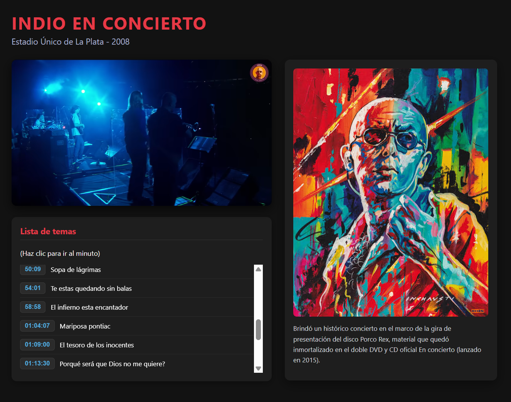

# 🎥 REPRODUCTOR DE VIDEO DE YOUTUBE

Una aplicación web interactiva y moderna para buscar y reproducir videos de YouTube utilizando la API de YouTube IFrame, desarrollada con HTML5, CSS3 y JavaScript.

[](https://coddy.tech)


---

## 📝 Sobre este proyecto
Este código fue creado como un ejercicio de práctica dentro del curso de **Coddy**.

* **Plataforma:** [Coddy.tech](https://coddy.tech)
* **Objetivo:** Practicar lógica de programación y desarrollo de software.

---

## 🚀 Características

*  **Búsqueda e Integración**: Permite incrustar y reproducir videos de YouTube de forma fluida mediante URLs válidas o IDs de video.
* **Formato Embed Correcto**: Manejo automático del formato https://www.youtube.com/embed/{VIDEO_ID} para evitar bloqueos de reproducción por directivas de seguridad (X-Frame-Options).
* **Diseño Responsivo**: Interfaz adaptable a dispositivos móviles, tablets y pantallas de escritorio.
* **Sin Dependencias Heavy**: Desarrollado con JavaScript Vanilla sin necesidad de frameworks pesados.

---

## 📂 Estructura del Proyecto

```text
├── index.html       # Estructura principal y contenedor del iframe
├── styles.css       # Estilos visuales, layout responsivo y temas
└── script.js        # Lógica de manipulación del DOM y procesamiento de URLs
```

---

## 🛠️ Tecnologías Utilizadas

* **HTML5**: Estructura semántica del reproductor y formulario de entrada.
* **CSS3**: Estilos responsivos, Flexbox/Grid y animaciones suaves.
* **JavaScript (ES6+)**: Extracción de IDs de URL de YouTube y actualización dinámica del iframe.

---

## 💻 ¿Cómo ejecutar el proyecto localmente?

1. Clona este repositorio en tu máquina local:

```text
git clone https://github.com/Maicol843/Reproductor.git
```

2. Navega al directorio del proyecto:

```text
cd Reproductor
```

3. Abre el archivo index.html en tu navegador preferido (o utiliza la extensión Live Server en VS Code).

---

<p align="center">
  
</p>

---

✨ Proyecto desarrollado como práctica de maquetación web, animaciones CSS y funciones JavaScript.
<p align="left">
  
  <b>Proyecto de Práctica | Realizado en <a href="https://coddy.tech/journeys/html/youtube_video_player__html_project">Coddy</a></b>
</p>
